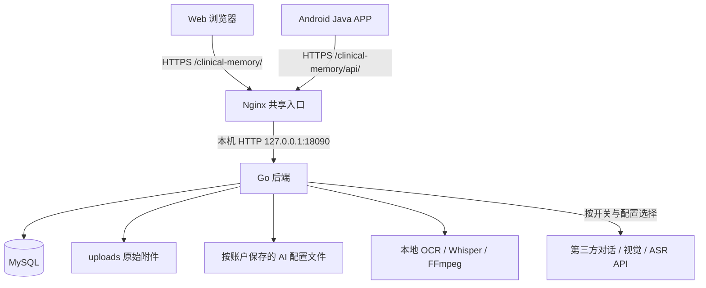
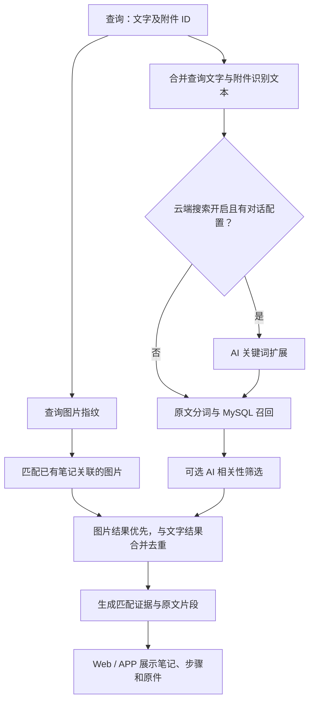
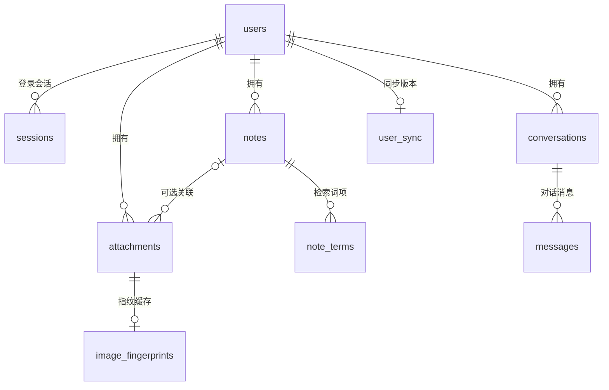
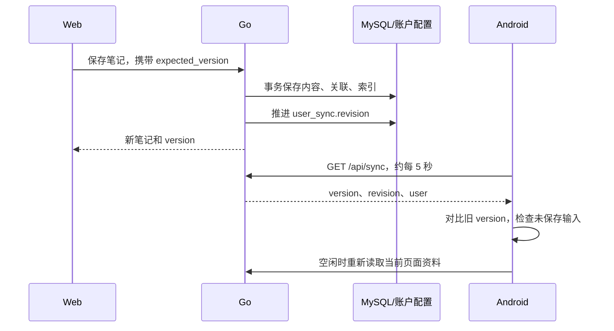

# 临记：多模态诊疗经验检索系统技术文档

> 首次编写：2026 年 10 月 28 日；最近更新：2026 年 10 月 29 日（北京时间）
> 面向读者：希望学习 Go、MySQL、原生 Java Android、Web 和 AI 检索集成的项目维护者。
> 依据：当前工作目录中的实际源码、数据库结构、部署配置和已有实测记录。本文描述的是当前工作区版本，不代表所有修改都已提交或推送至 GitHub。
> Android 当前工程版本：2.11.0-intranet / versionCode 14。文档不包含登录密码、数据库密码、API 密钥或服务器私钥。

## 内网分支更新（2026-10-29）

本分支采用内网统一 HTTPS 入口，Web 同源 API 与 Android 共用后端、MySQL、附件和账户配置。部署以 [内网部署说明](后端/deploy/intranet/README.md) 为准，本文原有腾讯云地址和操作保留为历史参考。

新增：`后端/deploy/intranet/` 的构建包、独立环境文件、Nginx 网段限制、systemd 服务和只读检查；App 构建参数 `linjiServerUrl`/`linjiCaCertificate`（精确主机信任内部 CA，Release 保持 HTTPS）；模型服务地址保存账户设置后保留管理员配置。未改数据库格式或增加多人共享/管理权限。外部 AI 与本地识别的边界保持原有设计。实际网络、证书及硬件容量需在部署目标验收。

## 阅读导航

1. [项目目标与功能范围](#s01)
2. [技术栈与选型理由](#s02)
3. [总体架构与数据流](#s03)
4. [目录结构与源码地图](#s04)
5. [数据库设计](#s05)
6. [Go 后端的运行机制](#s06)
7. [文字检索与倒排索引](#s07)
8. [图片指纹、OCR 与图文检索](#s08)
9. [音频转写与音频检索](#s09)
10. [云端 AI 接入与历史经验对话](#s10)
11. [Web 与 Android 的同步机制](#s11)
12. [Web 前端实现](#s12)
13. [Android Java 客户端实现](#s13)
14. [HTTP API 参考与调用示例](#s14)
15. [配置、鉴权与数据保护](#s15)
16. [本地开发与分别启动](#s16)
17. [腾讯云部署与 HTTPS 运维](#s17)
18. [备份、恢复与数据迁移](#s18)
19. [测试体系、实际结果与复测方法](#s19)
20. [当前限制与后续改进](#s20)
21. [学习路线与动手练习](#s21)
22. [常见问题排查](#s22)
23. [术语与源码阅读索引](#s23)

<a id="s01"></a>
## 1. 项目目标与功能范围

### 1.1 要解决什么问题

医生在工作中积累了笔记、治疗过程、图片、录音和文档。一段时间后，通常只能记住模糊线索，例如“以前整理过合谷的记录”“有一张肺部示意图”“我录过一段随访说明”。本项目将这些资料归入一个账户，通过不同形式的查询，找到相关历史笔记、已记录步骤和原始材料。

系统围绕“保存 → 识别 → 建立索引 → 查询 → 核对来源”组织功能。历史记录是资料来源，模型负责辅助理解或回顾，最终判断由使用者完成。

### 1.2 当前已经实现的功能

| 功能 | 当前实现 |
| --- | --- |
| 笔记管理 | 标题、分类、标签、纯文本正文、按顺序保存的步骤、记录日期、附件关联 |
| 材料管理 | 图片、音频、TXT、Markdown、PDF 上传；原件查看；识别文字修正；重新提取 |
| 文字检索 | Go 分词，MySQL 倒排索引，按匹配权重召回笔记 |
| 图片检索 | 文件 SHA-256 精确匹配、感知指纹近似匹配、图片文字检索、可选云端图片理解 |
| 音频检索 | 本地 Whisper 转写，或兼容接口的云端 ASR；根据转写文字检索 |
| 历史经验对话 | 检索个人笔记，显示来源，云端模型回顾或本地原文摘录 |
| 日常对话 | 主动调用所配置的对话模型，不自动检索个人资料库 |
| AI 服务设置 | Web 与 APP 中选择 DeepSeek、GLM、Kimi、MiniMax，保存模型名和密钥 |
| 云端搜索开关 | 按账户保存；关闭后上传识别、经验检索与历史回顾走本地路径 |
| 跨端同步 | 同一后端、同一账户，约 5 秒轮询版本；保护未保存输入；保存冲突检查 |
| 搜索结果阅读 | 匹配位置、关键词高亮、原文片段、前三项步骤、原始材料、鉴权缩略图 |
| Web 图片粘贴 | 检索框、对话框和笔记编辑处支持粘贴剪贴板中的图片文件 |
| 部署 | Go 原生服务、MySQL、Nginx、HTTPS、独立 URL 子路径、systemd 管理 |

### 1.3 三个容易混淆的概念

**检索与生成不同。** 检索得到已保存的记录；生成是模型根据资料组织新的回答。检索成功不代表模型回答的每一句话都正确。

**本地处理的“本地”指 Go 后端所在机器。** 当 APP 连接腾讯云时，本地 OCR、音频转写和图片指纹都在腾讯云服务器执行。手机仍需要联网访问后端。

**关闭云端 AI 不等于完全不使用模型。** 图片指纹是传统图像算法；OCR 和 Whisper 依然使用识别算法或模型，只是不向第三方模型 API 发送资料。

<a id="s02"></a>
## 2. 技术栈与选型理由

### 2.1 当前版本记录

以下版本来自工程配置或已有部署记录，不是对外部平台最新版本的判断。

| 层次 | 技术或版本 | 在项目中的作用 |
| --- | --- | --- |
| 后端语言 | Go，`go.mod` 声明 1.24.0 | HTTP、业务处理、文件管理、识别工具调用 |
| HTTP 框架 | 标准库 `net/http` | 按方法和路径注册路由，无 Gin 等框架依赖 |
| 数据访问 | `database/sql` + `go-sql-driver/mysql` 1.9.3 | SQL、连接池、事务、MySQL 驱动 |
| 配置读取 | `godotenv` 1.5.1 | 读取开发环境 `.env` |
| 密码派生 | `golang.org/x/crypto` 0.43.0 | PBKDF2-HMAC-SHA256 |
| 图像处理 | `golang.org/x/image` 0.32.0 | 缩放、WebP 解码、指纹、缩略图 |
| 文本编码 | `golang.org/x/text` 0.30.0 | 非 UTF-8 文本的 GB18030 解码 |
| 数据库 | MySQL，InnoDB，utf8mb4 | 账户、笔记、材料元数据、索引、会话与对话 |
| Web | HTML、CSS、原生 JavaScript | 无 npm 构建步骤的单页式界面 |
| Android | Java 源码兼容级别 17，原生 View | 无 Kotlin，非 WebView 包装 |
| Android 构建 | AGP 9.2.1、Gradle Wrapper 9.4.1 | 工程构建；已有记录使用 Android Studio JDK 21 |
| Android SDK | compileSdk/targetSdk 33，minSdk 26 | 当前最低设备 Android 8.0 |
| 图片文字识别 | macOS Vision 辅助工具 / Linux Tesseract | 本地 OCR |
| 音频识别 | whisper.cpp，Whisper base 多语言模型 | 本地语音转文字；云端部署使用 whisper.cpp v1.9.4 |
| 音频转换 | FFmpeg、ffprobe | 解码、采样率转换、时长检查 |
| PDF 文本 | Poppler `pdftotext`，可选安装 | 提取 PDF 已有文本层 |
| 云端入口 | Nginx + Certbot | HTTPS、反向代理、多个项目共享入口 |
| 进程管理 | systemd | 开机启动、失败重启、资源和文件权限限制 |

### 2.2 为什么这样组合

Go 适合把网络接口、数据库访问和外部命令调用放在一个可部署的服务中。MySQL 保存结构化数据，附件原件放文件系统，避免把大文件直接塞进业务表。两个前端只使用 HTTP API，业务规则集中在后端，因此不必分别实现两套检索和 AI 接入逻辑。

Web 使用原生技术，便于直接学习 DOM、事件、Fetch 和 CSS；Android 使用 Java 原生界面，便于理解 Activity、后台线程、系统文件选择器、录音和 Keystore。当前规模下，这些选择减少了框架层次，但也使部分源码文件承担了较多职责，后续可以逐步拆分。

<a id="s03"></a>
## 3. 总体架构与数据流

### 3.1 部署架构



本地开发可以绕过 Nginx，直接由 Go 的 8000 端口同时提供网页和 API。另一个可选 Web 进程监听 5173，只负责静态文件和 `/api` 代理。

### 3.2 保存资料的完整链路

1. 前端先上传材料，字段名为 `file`，请求类型为 `multipart/form-data`。
2. Go 验证扩展名、大小等条件，生成随机存储名，把原件写入 `DATA_DIR/uploads/`。
3. 根据文件类型提取文本：文字直接读取，图片 OCR 或云端视觉，音频本地或云端转写。
4. `attachments` 保存原件的位置、识别文本、状态和所属账户，返回 `attachment.id`。
5. 前端保存笔记时提交 `attachment_ids`，把材料关联到笔记。
6. 后端在事务内保存笔记、更新附件关联、重建该笔记的 `note_terms`。
7. 成功的业务写入推进账户同步版本，另一端在后续轮询中加载更新。

注意：上传和保存笔记是两个请求。材料可以先独立归档，再关联到笔记；关闭编辑框不会自动删除已经上传的原件。

### 3.3 多模态检索的完整链路



图片理解和语音转写主要发生在“上传或重新提取”阶段。后续检索使用已经保存的识别文本和指纹，不会因为每次刷新结果就重新识别所有附件。

### 3.4 数据分别放在哪里

| 数据 | 开发环境 | 当前云端 |
| --- | --- | --- |
| 业务记录、会话、倒排索引 | 本机 MySQL，通常数据库 `linji` | MySQL 数据库 `clinical_memory` |
| 原始附件 | `数据库数据/uploads/` | `/var/lib/clinical-memory/uploads/` |
| 按账户 AI 配置 | `数据库数据/ai-settings/用户ID.json` | `/var/lib/clinical-memory/ai-settings/用户ID.json` |
| 本地模型及语言包 | `数据库数据/models/` | `/var/lib/clinical-memory/models/` |
| 数据库连接等基础配置 | `后端/.env` | `/etc/clinical-memory/clinical-memory.env` |
| 数据备份 | 默认 `数据库数据/backups/` | 可用相同工具，需显式加载云端配置并指定输出位置 |

`数据库数据` 不是 MySQL 的 datadir。运行中的 InnoDB 引擎文件由 MySQL 服务管理；查看数据库应通过 SQL、管理工具或 SQL 导出。

<a id="s04"></a>
## 4. 目录结构与源码地图

```text
多模态AI数据库检索/
├── 项目技术文档.md                     本文
├── README.md                          使用入口与启动说明
├── 后端/
│   ├── go.mod / go.sum                 Go 模块与依赖锁定
│   ├── .env.example                    基础配置模板，不是真实凭据
│   ├── run.sh                          启动 Go 服务
│   ├── setup-db.sh                     首次建库与应用账户初始化
│   ├── setup-local-search.sh           本地 OCR / ASR 准备
│   ├── backup.sh                       SQL 与附件备份
│   ├── cmd/
│   │   ├── server/                     服务与独立 Web 模式入口
│   │   ├── setup-db/                   数据库初始化命令
│   │   ├── db-info/                    查看数据统计
│   │   ├── import-samples/             导入虚构多模态示例
│   │   └── backup/                     备份命令实现
│   ├── internal/server/
│   │   ├── config.go                   环境配置与 MySQL DSN
│   │   ├── http.go                     路由、中间件、子路径支持
│   │   ├── auth.go                     密码、会话、登录限流
│   │   ├── models.go                   请求/响应结构和校验
│   │   ├── store.go                    数据访问、事务、分词与索引
│   │   ├── schema.sql                  编译进后端的建表 SQL
│   │   ├── notes.go                    笔记、搜索、对话和统计接口
│   │   ├── attachments.go              上传、原件、提取文本、删除
│   │   ├── thumbnails.go               鉴权图片缩略图
│   │   ├── image_search.go             图片指纹与多路结果合并
│   │   ├── search_evidence.go          匹配字段、关键词和摘录
│   │   ├── retrieval.go                AI 辅助召回和相关性筛选
│   │   ├── ai.go                       模型 HTTP 适配、提取和回答
│   │   ├── local_extract.go            本地 OCR / ASR
│   │   ├── ai_settings.go              按账户配置与云端搜索开关
│   │   ├── sync.go                     同步版本和个人信息
│   │   ├── samples.go                  虚构测试材料导入
│   │   └── *_test.go                   单元、集成与可选实测
│   ├── tools/                          本地识别辅助源码等
│   ├── deploy/                         systemd、Nginx、部署说明
│   └── output/                         本机私有测试记录，Git 忽略
├── 前端Web/
│   ├── index.html                      页面骨架与 SVG 导航图标
│   ├── styles.css                      主题、布局、响应式和结果样式
│   ├── app.js                          页面状态、API、事件与同步
│   ├── demo-match.js / demo-assets.json 固定演示文件匹配
│   └── run.sh                          独立 Web 代理模式
├── 前端APP/
│   ├── build.gradle / settings.gradle  Groovy 工程配置
│   ├── gradlew / gradle/               Gradle Wrapper
│   └── app/
│       ├── build.gradle                Android 版本与 SDK 配置
│       └── src/main/
│           ├── AndroidManifest.xml      权限、Activity 和 Provider
│           ├── java/cn/linji/clinical/
│           │   ├── MainActivity.java    页面与交互流程
│           │   ├── Api.java             JSON、上传和鉴权下载
│           │   ├── TokenStore.java      Keystore 会话加密
│           │   ├── CacheProvider.java   原件临时只读共享
│           │   ├── Json.java            JSON 访问辅助
│           │   └── LineIcon.java        原生线条图标
│           ├── assets/                 固定演示资料与清单
│           └── res/values/styles.xml   Android 样式
└── 数据库数据/
    ├── 初始化.sql                      建库与授权参考
    ├── schema.sql                      便于查看的表结构副本
    ├── 测试资料/                       虚构笔记、授权图片、合成录音
    ├── uploads/                        上传原件，忽略 Git
    ├── ai-settings/                    账户模型密钥，忽略 Git
    ├── models/                         离线识别资源，忽略 Git
    └── backups/                        SQL 和原件备份，忽略 Git
```

学习时先看 `models.go` 和 `schema.sql`，再看 HTTP 路由，最后跟踪某一项功能进入业务函数。只阅读 `MainActivity.java` 或 `app.js`，容易看到很多界面细节，却不知道数据结构为什么这样设计。

<a id="s05"></a>
## 5. 数据库设计

### 5.1 关系模型

当前内嵌建表脚本定义 **11 张表**，使用 InnoDB。主要关系如下：



`app_state` 用于首次初始化锁，`login_attempts` 按 IP 记录登录尝试，不直接挂在上述业务关系中。

### 5.2 users：软件账户

| 字段 | 类型 | 含义 |
| --- | --- | --- |
| `id` | BIGINT 自增主键 | 账户 ID |
| `username` | VARCHAR(64)，ASCII 二进制比较，唯一 | 登录名，区分大小写 |
| `password_hash` | VARCHAR(200) | 盐与密码派生结果，非明文密码 |
| `display_name` | VARCHAR(40) | Web 和 APP 展示名称 |
| `created_at` | VARCHAR(35) | UTC RFC3339 格式时间 |

当前公开初始化接口只允许创建系统的第一个账户，不提供普通用户自助注册界面。数据库和归属检查具备多账户隔离基础，但不能据此认为已经实现完整的多用户管理后台。

### 5.3 notes：统一笔记格式

| 字段 | 类型 | 含义 |
| --- | --- | --- |
| `id` | CHAR(32) | 16 个随机字节编码成 32 位十六进制标识 |
| `user_id` | BIGINT 外键 | 所属账户 |
| `title` | VARCHAR(160) | 标题 |
| `category` | VARCHAR(40) | 分类，例如诊疗笔记、经验总结、随访记录 |
| `tags` | JSON | 标签字符串数组 |
| `content` | MEDIUMTEXT | UTF-8 纯文本正文 |
| `steps` | JSON | 有顺序的步骤字符串数组 |
| `occurred_on` | DATE | 业务记录日期，接口使用 YYYY-MM-DD |
| `created_at` / `updated_at` | VARCHAR(35) | 创建和更新时间 |

索引 `notes_owner_date(user_id, occurred_on)` 帮助按账户及记录日期查找。列表按记录日期、更新时间和 ID 排序。

这里没有富文本 HTML 或 Markdown AST。正文中的换行作为文本保留；Web 用 `white-space: pre-wrap` 显示，Android 用 TextView 显示。步骤单独存数组，避免把“步骤顺序”隐含在富文本排版里。

接口中的 `version` 是读取时对笔记内容及附件信息计算的摘要，不是 notes 表中的独立字段。编辑提交 `expected_version` 后，服务端可判断是否基于过期内容修改。

### 5.4 attachments：材料元数据

| 字段 | 类型 | 含义 |
| --- | --- | --- |
| `id` | CHAR(32) | 材料 ID |
| `user_id` | BIGINT | 所属账户 |
| `note_id` | 可空 CHAR(32) | 关联笔记；NULL 表示尚未关联 |
| `filename` | VARCHAR(180) | 用户原始文件名 |
| `stored_name` | VARCHAR(80) | 服务器随机存储名，接口不公开此字段 |
| `mime` | VARCHAR(80) | 后端按支持的扩展名映射的媒体类型 |
| `size` | BIGINT | 原件字节数 |
| `extracted_text` | MEDIUMTEXT | OCR、转写、视觉描述或人工修正文字 |
| `status` | VARCHAR(30) | 识别处理状态 |
| `created_at` | VARCHAR(35) | 创建时间 |

一个附件当前最多关联一篇笔记。给多个笔记重复关联同一个附件会被拒绝；需要复用时要调整关系模型或分别上传。若未来需要一份材料关联多篇笔记，应增加笔记—材料关系表，而不是在 `note_id` 中写逗号分隔的 ID。

常见状态：

| 状态 | 含义 |
| --- | --- |
| `ready` | 已有可用识别文本；文本仍需人工核对 |
| `needs_transcript` | 暂无可用文字，可人工补充 |
| `extraction_failed` | 提取失败；有效原件通常仍保留，界面提示重新提取或填写文字 |

`extraction_error` 是上传响应中可能返回的提示字段，当前不是持久化数据库列。后续重新打开材料主要读取状态和已保存文本。

### 5.5 note_terms：文字倒排索引

| 字段 | 类型 | 含义 |
| --- | --- | --- |
| `note_id` | CHAR(32) | 哪篇笔记 |
| `term` | VARCHAR(64)，utf8mb4_bin | 分词后的词项 |
| `weight` | INT | 该词项在笔记中的累计权重 |

联合主键 `(note_id, term)` 防止同一笔记重复存同一个词项；索引 `(term, note_id)` 支持“从词查笔记”。

正文、步骤、关联材料文字每出现一次通常增加 1；标题、分类、标签每出现一次增加 4；每个词项权重上限 100。它是项目自定义的词项加权方案，没有实现 BM25 的 IDF 或文档长度归一化。

### 5.6 conversations 和 messages：对话

`conversations` 保存 `id、user_id、mode、title、created_at`；`mode` 为 `knowledge` 或 `general`。

`messages` 保存 `id、conversation_id、role、content、sources、created_at`。其中 `sources` 是 JSON，存笔记 ID、标题、记录日期等来源摘要。它并不是当时整篇笔记和原件的不可变快照；笔记删除后，旧回复和来源摘要仍在，但来源链接可能无法再打开。

### 5.7 其他表

| 表 | 关键字段 | 作用 |
| --- | --- | --- |
| `sessions` | token_hash、user_id、expires_at | 保存会话摘要和过期时间；原始 token 不写入数据库 |
| `user_sync` | user_id、revision | 每个账户的业务变更版本 |
| `image_fingerprints` | attachment_id、fingerprint JSON | 缓存 SHA-256、pHash、dHash、均色和细节标记 |
| `login_attempts` | ip、attempts、started | 5 分钟窗口的登录尝试计数 |
| `app_state` | id，固定初始化行 1 | 用行锁保证并发初始化时只创建首个账户 |

AI 配置当前不在 MySQL 表中，而是在后端文件系统。两端同步配置，意味着它们读取同一个后端文件，并不是互相复制密钥。

### 5.8 删除行为和一致性

- 删除笔记：删除词项；附件 `note_id` 变为 NULL，原始材料保留。
- 删除附件：删除材料行及其指纹缓存；若原来关联笔记，重建笔记索引；再删除原件文件。
- 删除对话：消息通过外键级联删除。
- 修正附件文字：更新文本，并在事务内重建关联笔记的索引。

数据库事务只能保证 SQL 的原子性，不能自动把文件系统操作也纳入同一事务。例如附件数据库行删除成功后，若原件删除失败，需要运维处理遗留文件。这是文件存储系统中需要额外关注的一致性边界。

### 5.9 建表机制

`store.go` 通过 `//go:embed schema.sql` 将 SQL 编译到程序。启动时执行 `CREATE TABLE IF NOT EXISTS` 等语句，初次部署自动建表。`数据库数据/schema.sql` 保留便于查看的副本；`TestSchemaMirror` 检查两份结构的一致性。

当前是轻量初始化机制，不是带编号、可升级/回滚的迁移系统。以后给既有表新增列，不能只改 `CREATE TABLE IF NOT EXISTS`，还需要显式迁移步骤。

<a id="s06"></a>
## 6. Go 后端的运行机制

### 6.1 启动过程

入口：`后端/cmd/server/main.go`。

```text
解析命令行参数
  → LoadConfig 查找项目根目录、加载 .env
  → 建立 MySQL 连接池并 Ping
  → 执行内嵌建表 SQL
  → 准备 uploads 目录
  → 注册 HTTP 路由
  → 按 PUBLIC_BASE_PATH 包裹路由
  → ListenAndServe
```

如果设置 `-web`，程序只启动独立 Web 静态服务和 API 代理，不创建第二套业务数据库。

配置优先级是：已经存在的进程环境变量优先，`.env` 补充未设置的变量，再使用代码默认值。`PROJECT_ROOT` 可直接指定项目根目录；未设置时从当前目录逐级向上找 `前端Web/index.html`。

### 6.2 连接池与超时

当前连接池最多 20 个打开连接、5 个空闲连接，连接最大生存时间 5 分钟。启动 Ping 最长 10 秒；MySQL 驱动连接超时 5 秒，读写超时各 20 秒。

HTTP 服务有请求头、读、写和空闲超时。较长的读写超时用于等待上传、OCR、语音识别和云端调用。它不表示能够无限并发处理识别任务，后续仍需要并发限制和任务队列。

### 6.3 一次鉴权请求怎么处理

外部子路径先由 `WithBasePath` 匹配和剥离；之后经过响应头/同源检查与错误恢复，再进入路由。受保护路由通过 `guard`：

1. 从 Bearer Header 或 Cookie 读取会话 token。
2. 对 token 计算 SHA-256，查询有效 session 和所属 user。
3. 加载当前账户的 AI 配置，并通过请求 Context 传递。
4. 执行业务函数，所有资源读取检查所属账户。
5. 对纳入同步范围的成功写入推进 `user_sync.revision`。

Context 的作用是让本次请求使用本账户配置，避免把甲用户的密钥改成进程全局配置，误用于乙用户请求。

### 6.4 为什么没有复杂分层目录

当前使用一个 `server` 包，按文件职责划分 HTTP、持久化、AI 和识别处理。它不属于完整的 Controller/Service/Repository 多层架构。这样的组织在原型期便于追踪，但 `store.go`、`notes.go` 和前端主文件后续适合继续拆分。

### 6.5 事务与并发控制

`withTx` 统一开始事务、提交，异常退出时回滚。笔记保存会把笔记内容、附件归属和索引更新放在事务中；需要排他检查的地方使用 `SELECT ... FOR UPDATE`。

首账户初始化锁定 `app_state`；附件关联锁定相关记录；笔记编辑先锁定并检查旧版本。AI 配置文件由进程内互斥锁、临时文件和原子重命名保护。

这些机制足以支持当前单 Go 实例，但不等于已经解决跨多个后端实例的文件配置并发，扩容时要重新设计。

### 6.6 错误处理约定

接口错误统一为 JSON：

```json
{"detail":"这篇笔记已在其他设备更新，请保留当前输入并重新打开最新笔记"}
```

业务函数使用 `fail(status, detail)` 触发可识别的错误，再由 HTTP recover 层转为状态码和 JSON。未知错误记录后端日志并返回通用 500。JSON 解码拒绝未知字段和多余的第二个 JSON 对象，有助于发现客户端字段名写错。

| 状态码 | 常见含义 |
| --- | --- |
| 200 / 201 | 成功读取、更新 / 成功创建 |
| 400 | 上传格式或文件内容有问题 |
| 401 | 未登录、密码错误、会话过期 |
| 403 | 非同源写入被拒绝 |
| 404 | 资源不存在，或不属于当前账户 |
| 409 | 初始化已完成、版本冲突、附件归属冲突 |
| 413 / 415 | 文件过大 / 文件扩展名不支持 |
| 422 | 输入校验、日期、字段范围、无法解码等问题 |
| 429 | 登录尝试次数过多 |
| 502 / 503 | 上游模型错误 / 本地识别工具未就绪等 |

<a id="s07"></a>
## 7. 文字检索与倒排索引

### 7.1 什么是倒排索引

普通存储回答“这篇笔记写了什么”；倒排索引回答“含有这个词的笔记有哪些”。

假设笔记 N1 的标题是“合谷 LI4 回顾”，索引会保存“合谷 → N1”“li4 → N1”等关系。搜索时直接按词项找候选，无需读取全部笔记逐字扫描。

### 7.2 当前分词规则

`tokens` 在 Go 中完成：

- 连续中文按单字和相邻双字切分。
- 英文字母和数字形成小写词。
- 标点、空白和其他字符结束当前词段。
- 单个英文数字词最多保留 64 个字符。

例如：

```text
输入：合谷 LI4 随访
索引词：合、合谷、谷、li4、随、随访、访
```

查询阶段优先选取长度大于 1 且不在通用停用词中的词，例如“合谷”“li4”“随访”。没有可用长词时回退到原始词项，查询词最多保留 100 个。

它不依赖 MySQL ngram 插件，也不使用完整中文词典。因此配置简单，但对拼写错误、复杂同义表达和罕见专有名词的理解有限。

### 7.3 保存时如何建索引

`reindex(tx, noteID, userID)`：

1. 读取笔记和关联材料。
2. 删除这篇笔记原有 `note_terms`。
3. 从正文、步骤、材料文字提取词，累计普通权重。
4. 从标题、分类、标签提取词，累计较高权重。
5. 每批最多 500 个词项写入索引。

重建发生在保存笔记、修正材料文字、重新提取、解除材料关联或删除材料等场景。不是每次搜索都全量重建。

### 7.4 查询如何排序

以下 SQL 是与实现等价的简化示意：

```sql
SELECT n.id, SUM(t.weight) AS relevance
FROM note_terms AS t
JOIN notes AS n ON n.id = t.note_id
WHERE t.term IN (?, ?, ?)
  AND n.user_id = ?
GROUP BY n.id
ORDER BY relevance DESC, n.id
LIMIT ?;
```

需要分类过滤时增加 `AND n.category = ?`。词项通过参数占位符传入，不把模型输出拼成可执行 SQL。

当前是满足任一候选词即可进入的召回，再累加命中权重；分数不代表医学可信度，也不是概率。标题和标签更重要，所以认真填写标题、标签往往比依赖后续 AI 更有效。

### 7.5 一条文字查询的例子

用户输入“找手背虎口的历史记录”：

- 本地模式按“手背”“虎口”等词查询已有索引；若笔记里没有这些词，就可能找不到。
- 云端搜索模式可先由模型整理同义线索，再召回候选并筛选。
- 模型不能凭空恢复没有保存到系统中的治疗过程。

### 7.6 当前检索单位是笔记

返回结果是 `Note[]`，不是独立附件列表。材料文字只有关联到某篇笔记后，才通过该笔记索引参与历史资料召回；指纹候选也要求已有图片关联笔记。

查询时上传的图片/音频可以尚未关联笔记，它们提供本次查询线索；但资料库里一份长期孤立的材料不会自动成为独立搜索结果。若希望所有未关联材料也能独立检索，后续需要增加材料索引和结果类型。

<a id="s08"></a>
## 8. 图片指纹、OCR 与图文检索

### 8.1 三种能力分别解决什么问题

| 路径 | 可以解决 | 主要限制 |
| --- | --- | --- |
| 图片指纹 | 原图重复上传，缩放、重新编码后查找相似原图 | 不能理解图中器官或穴位语义 |
| 本地 OCR | 根据图片里的“合谷 LI4”等可见文字查笔记 | 无文字图片无法由 OCR 推出穴位名称 |
| 云端视觉 | 从支持图片输入的模型获取文字转录和可见内容描述 | 受模型能力、网络、权限和误识别影响 |

“上传图片查出相关文字”有两种典型过程：图片指纹先匹配历史图，再找到它所属的笔记；或者 OCR/视觉生成文字，再查询笔记的文本索引。

### 8.2 SHA-256：完全相同的文件

读取文件原始字节计算 SHA-256。摘要完全相同则标记 `method = exact`，距离为 0。

改变压缩质量、另存为 JPEG、修改图像元数据等都可能改变字节摘要，因此需要感知指纹补充。

### 8.3 pHash：低频图像结构

当前代码将图片合成到白底并缩为 32×32，按灰度计算二维 DCT 的低频 8×8 系数。除去直流项，用其余系数的中位数作阈值，得到保存在 uint64 中的指纹。

比较两个指纹时，对它们异或，再统计二进制 1 的个数，即汉明距离。距离小表示指纹结构更接近。

### 8.4 dHash、均色与细节过滤

dHash 将图片缩为 9×8，比较每行相邻像素的明暗变化，生成 64 位差分指纹。额外保存 RGB 均色和灰度方差判断的细节标记，减少纯色图等误匹配。

当前近似匹配条件必须同时满足：

```text
两张图都具有足够细节
pHash 汉明距离 ≤ 6
dHash 汉明距离 ≤ 10
RGB 三个通道均色差的绝对值之和 ≤ 75
```

这是代码中的工程阈值，未经大规模资料集校准。返回的 `distance` 是 pHash 汉明距离，不应展示成“相似度 98%”或诊断置信度。

### 8.5 指纹缓存和搜索成本

指纹保存在 `image_fingerprints.fingerprint` JSON。第一次用到旧材料时补建缓存，后续直接读取。删除材料会级联删除指纹行。

当前实现会读取该账户下已关联笔记的图片候选，再逐个比较。若已有 N 张候选、Q 张查询图，比较规模大致为 O(N×Q)，Q 最多 5。个人资料库可用，但成千上万张图之后应考虑可索引的哈希检索、分桶或专门检索服务。

### 8.6 本地 OCR

- macOS 优先使用本地 Vision 辅助程序 `models/tools/linji-ocr`。
- 其他环境使用 Tesseract，语言为 `chi_sim+eng`，代码参数采用 `--psm 11`。
- OCR 输出写入 `attachments.extracted_text`。
- 修正文本后，关联笔记会重新索引。

有文字的卡片、截图和扫描文字更适合 OCR。模糊照片、低对比度文字、复杂标注会降低识别质量。当前 PDF 文本提取也没有自动逐页 OCR 扫描 PDF。

### 8.7 合并图像和文字结果

`retrieveInput` 先获得图片匹配，再获得文字候选，按笔记 ID 去重。图片结果优先，文字结果补充。有效图片匹配不会因为云端相关性筛选未保留而被清除。

后端会附加：

```json
{
  "search_match": {
    "terms": ["合谷", "li4"],
    "fields": ["title", "content", "image"],
    "excerpt": "包含检索词的原文片段……",
    "source": "正文",
    "attachment_ids": ["历史图片ID"],
    "image_matches": [{
      "attachment_id": "历史图片ID",
      "query_attachment_id": "查询图片ID",
      "method": "perceptual",
      "distance": 3
    }]
  }
}
```

以上 ID 和数值是结构示例，不是某次真实查询输出。前端根据这些字段解释“为什么这篇笔记出现在结果中”。

### 8.8 如何可靠使用图片检索

先保存一篇有明确标题和标签的笔记，把历史图片关联进去，再用同图或变换后的图片查询。若只拍摄一张全新的、无文字、不同视角的手部照片，本地指纹和 OCR 都不能保证确定穴位；需要语义模型或更专门的识别系统，并单独验证。

<a id="s09"></a>
## 9. 音频转写与音频检索

### 9.1 当前不做声音指纹搜索

系统没有实现“按音色、背景声或同一段录音的波形找相似录音”。音频首先被转写为文字，再进入与文字查询相同的索引链路。

### 9.2 本地 ASR 流程

```text
上传音频
  → ffprobe 读取时长
  → 检查：有效且不超过 120 秒
  → FFmpeg 转成 16kHz、单声道、PCM 16-bit WAV
  → whisper-cli 加载 ggml-base.bin
  → 读取转写 TXT
  → 保存 extracted_text
  → 关联笔记索引 / 提供本次查询文字
```

代码为推理阶段设置 150 秒 Context 超时，Whisper 使用 4 个线程、CPU 模式和自动语言识别，并给出合谷 LI4、足三里 ST36、内关 PC6 等中文专有词提示。提示只能辅助，不保证编号正确。

临时 WAV 和 TXT 放入临时目录，结束后清理。超过 120 秒先提示分段上传，不会把一段长录音静默截成前 120 秒并宣称全部识别完成。

### 9.3 云端 ASR

当云端搜索开启且 ASR 地址与密钥均有效时，上传音频到：

```text
POST {ASR_BASE_URL}/audio/transcriptions
multipart: file、model、language=zh
```

响应应包含 `text`。对话模型密钥和音频转写服务是两项配置；配置了 DeepSeek 对话不代表云端 ASR 自动可用。

### 9.4 错字如何影响结果

已有本地测试中，“合谷”被保留，因此可以命中笔记；“查找”“穴位”“LI4”分别出现过“插找”“学位”“L24”等误识别。若检索只依赖错误编号，就可能漏召回或误召回。

解决路径是保留原件、显示转写、允许人工修正。保存修正文本后索引同步更新，比把错误转写隐藏在界面后更便于核对。

### 9.5 录音权限与网络

Web 使用 `getUserMedia` 和 `MediaRecorder`，需要浏览器麦克风权限及 localhost/HTTPS 安全上下文。真机 Android 使用原生 `MediaRecorder` 和 `RECORD_AUDIO` 权限，不受浏览器安全上下文规则限制，但 HTTP/HTTPS 仍受 APP 构建配置约束。

<a id="s10"></a>
## 10. 云端 AI 接入与历史经验对话

### 10.1 对话、视觉、音频分开配置

界面可分别选择对话/检索提供商、图片理解提供商和 ASR 服务。不同服务可使用不同模型或密钥。

四个内置对话/视觉提供商使用兼容 `POST /chat/completions` 的适配方式。当前界面使用代码内置的官方基础 URL；ASR 可以填写兼容基础 URL。模型名称可以编辑，实际能否调用取决于平台支持、账户权限及额度。工程默认模型名只代表当前配置值。

源码中的 `DeepSeekKey/URL/Model` 是历史命名，在运行时也承载选中的其他对话提供商参数。不能仅根据字段名就认定实际请求一定发给 DeepSeek。

### 10.2 模型请求格式

简化示例：

```json
{
  "model": "你实际可用的模型名",
  "messages": [
    {"role": "system", "content": "任务约束"},
    {"role": "user", "content": "用户问题或结构化候选资料"}
  ],
  "max_tokens": 3000,
  "stream": false
}
```

密钥在后端加入 `Authorization: Bearer ...`。当前不是流式输出，前端等到本次调用完成再显示。图片理解使用消息内容中的 `image_url`，把图像编码为 Base64 data URL 发送给所选视觉模型。

### 10.3 AI 参与检索的两步

**关键词扩展。** 模型从输入中提取明确关键词和常见同义词，要求返回 `{"keywords":[...]}`，最多保留 12 项。整理出的词与原查询一起进入 MySQL 检索，模型输出不作为 SQL 执行。

**相关性筛选。** 从 MySQL 召回有限候选，最多 40 篇；把候选 ID、标题、标签、截断正文和材料文本给模型，要求只返回相关候选的 ID。服务端再检查每个 ID 是否属于本次候选集合，拒绝任意新 ID。

关键词扩展和相关性筛选各有 25 秒 Context 超时。失败时保留本地检索，并在 `warnings` 说明。云端相关性筛选合法返回空数组时，文字候选可以被全部排除；独立图片匹配仍可进入合并结果。

### 10.4 这属于怎样的 RAG

RAG 指检索后把资料作为上下文提供给生成模型。本项目的历史经验对话采用这一思路，但底层召回使用关系数据库词项索引和图片指纹。

当前没有向量数据库、Embedding 检索、统一多模态向量、文档分块向量化或模型训练。可以称为“关键词与图像指纹召回、可选大模型筛选和生成”的检索增强应用。

### 10.5 knowledge：历史经验回顾

1. 读取本次问题和主动附加材料文字。
2. 检索当前账户最多 5 篇相关笔记。
3. 整理标题、正文、步骤及材料文字。
4. 读取该对话最近最多 12 条历史消息。
5. 请求模型按来源回顾，并要求使用 `[笔记:实际ID]` 标注。
6. 保存用户问题、模型回答及来源摘要。

当前来源列表来自后端实际检索的笔记，回答文字由模型生成。提示词要求引用真实 ID，但代码并未对模型每一句引用做严格事实验证，所以仍需点击来源核对。

没有对话密钥或关闭云端搜索时，knowledge 返回“本地检索摘录”，直接列出正文、步骤和材料片段，不调用生成模型。

### 10.6 general：日常对话

日常对话主动使用对话服务，不自动读取个人笔记库。用户自己附加的材料文字仍会进入当前请求。

云端搜索开关主要控制上传识别、检索与历史回顾；它不会禁止用户主动发起 general 云端对话。这一点在涉及私密资料时尤其需要理解。

### 10.7 开关与降级行为

| 场景 | 关闭云端搜索 | 开启云端搜索 |
| --- | --- | --- |
| 图片指纹 | 使用 | 使用 |
| 新上传图片 | 本地 OCR | 配置视觉密钥时用云端视觉，否则本地 OCR |
| 新上传音频 | 本地 Whisper | 有完整 ASR 配置时用云端，否则本地 Whisper |
| 文字检索 | 原文与已有材料文字索引 | 可选关键词扩展和相关性筛选 |
| 历史回顾 | 本地摘录 | 有对话配置时模型生成，否则本地摘录 |
| 日常对话 | 仍可主动调用已配置的云端对话服务 | 云端对话 |
| 已有云端识别文字 | 保留并参与本地搜索 | 继续使用 |

云端视觉/ASR 调用失败时，上传接口会保留有效原件并标记提取失败，不会保证自动再次切换本地重试。用户可以关闭开关后点击“重新提取”，或人工补充文字。关键词整理和相关性筛选的失败回退与上传识别失败处理是不同机制。

### 10.8 配置保存在哪里

`DATA_DIR/ai-settings/{userID}.json` 保存所选服务、模型、密钥、ASR 和搜索开关，目录 0700、文件 0600。保存采用临时文件再原子重命名；前端仅收到 `has_key` 等状态，不回显完整密钥。

填写空密钥表示保留，`clear_key=true` 表示删除。编辑请求可提交 `expected_version` 防止覆盖另一端更新。

这些文件未做静态加密，也不包含在普通 SQL+uploads 备份中。读取服务器数据目录的人员仍可获取密钥。旧 `.env` 的模型配置只在账户尚未保存界面设置时作为共享默认值使用；界面保存后切换到该账户配置。

<a id="s11"></a>
## 11. Web 与 Android 的同步机制

### 11.1 同步的前提

两端必须使用同一个服务地址对应的后端、同一个软件账户。连接本机库和云端新库，即使用户名都叫 doctor，也不会自动同步；目前没有本机与云端双向复制功能。

### 11.2 核心是共享存储与版本轮询



`GET /api/sync` 返回：

```json
{
  "version": "由版本、账户和配置摘要计算的字符串",
  "revision": 12,
  "user": {"id": 1, "username": "doctor", "display_name": "医生"},
  "note_format": "plain-text-v1",
  "poll_seconds": 5
}
```

### 11.3 哪些操作会推进版本

成功的笔记、附件、对话、个人显示名称、模型配置和搜索开关变更等进入同步范围。同步摘要还包含账户信息和配置内容摘要，因此能感知某些非界面配置修改。

当前版本推进由成功响应后的中间层执行，和业务写入不是同一 SQL 事务。若这一步单独失败，会记录日志，其他端可能延迟感知；手动刷新仍可重新读到数据库的真实数据。这也是以后强化一致性时可以改进的地方。

### 11.4 如何保护正在编辑的内容

- Web 检查弹窗、录音、已附加文件、配置表单脏状态和查询/对话输入。
- APP 检查编辑窗口、正在操作、输入草稿、录音和设置修改状态。
- 检测到更新但有草稿时，暂缓自动刷新。
- 手动强制同步可能丢弃未保存内容，因此界面提示确认。
- 已展示的旧搜索结果不会因资料更新自动再次调用 AI，需要用户重新发起查询。

### 11.5 并发编辑与 409

Web 和 APP 读取同一笔记的 V1。Web 先保存为 V2；APP 仍用 V1 的 `expected_version` 提交时，服务端返回 409，要求保留输入、重新读取最新版本后再修改。

当前冲突保护依赖提交 `expected_version`，字段为空的外部 API 调用不会获得同样的版本比较保护；显示名称、材料文字和删除操作也不是完整统一的乐观锁。不存在 CRDT、实时协同编辑或自动逐行合并。

### 11.6 不是离线同步

APP 没有 Room/SQLite 本地业务库、离线写入队列或冲突重放。网络不可用时无法继续查询后端资料。约 5 秒是前台空闲轮询间隔，不是所有网络条件下的同步时延承诺。

<a id="s12"></a>
## 12. Web 前端实现

### 12.1 页面与状态

`index.html` 提供登录区、侧栏、顶栏、主内容区、dialog 和 toast。`app.js` 的 `state` 保存当前页面、账户、能力、统计、笔记、检索结果、附件和对话等。

页面使用 URL Hash，例如 `#search`、`#notes`、`#materials`、`#chat`、`#settings`。`navigate` 读取必要接口并渲染主内容，避免引入路由框架。

### 12.2 API 封装

`api(path, options)` 统一添加 `/api` 前缀、JSON 序列化和 `credentials: same-origin`，统一读取错误提示；401 时返回登录状态。

`APP_BASE` 根据当前脚本 URL 推导，因此在根路径和 `/clinical-memory/` 下都能构造相应的接口和缩略图地址。HTML 引用资源采用相对路径，部署时需要保持目录结构。

Web 登录使用 HttpOnly Cookie。页面不把登录 token 写入 localStorage，也不自己保存完整 API 密钥。

### 12.3 图片复制粘贴

`clipboardImages` 检查 `ClipboardEvent.clipboardData.items/files`；`bindImagePaste` 在对应输入区域处理：

1. 发现图片文件后阻止浏览器把它按普通文本粘贴。
2. 检查支持的类型、大小和剩余数量。
3. 显示上传/识别进度及临时预览。
4. 通过上传接口获得材料 ID。
5. 追加到查询、对话或笔记材料列表。

粘贴图片文件与粘贴图片网址不同。只复制 URL 时按文字处理，不会自动去外部网站下载图片。查询和对话最多 5 份材料，笔记最多关联 20 份。

### 12.4 搜索结果为什么更容易核对

结果卡片按“编号/分类/日期 → 标题 → 匹配位置 → 原文片段 → 已记录步骤 → 原始材料 → 完整记录入口”组织。

高亮词来自后端 `search_match.terms`，原文片段优先选择正文、步骤或材料中的上下文。缩略图仍经过鉴权；点击打开原件。搜索只显示前三步，避免长步骤挤满列表，完整记录保留全部内容。

没有直接文字证据但被 AI 判为相关时，界面提示核对原文，不把它伪装成精确关键字匹配。

### 12.5 UI 样式和图标

当前使用浅色背景、白色内容区、绿色强调色、细边框和系统中文字体。导航主图标采用内联 SVG，并显式设置 `fill="none"` 和 `stroke="currentColor"`，减少依赖特殊字体造成的黑方块/缺字显示。

CSS 使用媒体查询适配窄屏，保留按钮 focus 状态、表单标签、图片 alt 和状态提示。前端文件配置 `no-cache` 重新验证，升级后仍建议强制刷新以排除旧标签页缓存。

### 12.6 当前可维护性取舍

多数界面逻辑集中在一个 `app.js`，部分模板行较长；学习时可按 API、同步、笔记、检索、材料、对话、设置拆读。规模继续扩大时，适合拆分模块、添加界面自动化回归，但不必为了拆文件立刻重写整个框架。

<a id="s13"></a>
## 13. Android Java 客户端实现

### 13.1 原生界面结构

`MainActivity` 使用原生 LinearLayout、TextView、EditText、Button、Dialog 等动态构建页面。它不依赖 WebView 来显示 Web 前端，也没有使用 Kotlin 或 Compose。

`LineIcon` 绘制线条图标，颜色和圆角等由 Java 与 `styles.xml` 控制。业务功能对应检索、笔记、材料、对话、设置五个主要页面。

### 13.2 网络不能阻塞主线程

APP 用单线程 `ExecutorService` 执行 HTTP、上传和下载等操作，完成后回到 UI 线程更新 View。同步任务通过主线程 Handler 定时安排，在后台执行请求。

单线程便于避免同时写 UI 状态，但长音频识别请求也会延后其他网络任务。当前没有后台持久任务队列；退出或系统销毁 Activity 时应按现有生命周期代码处理。

### 13.3 Api.java

基于 `HttpURLConnection`：

- 地址为 `baseUrl + "/api" + path`，baseUrl 可带 `/clinical-memory`。
- 请求携带 `Authorization: Bearer <token>`。
- JSON 接口统一解析；错误包装成带 HTTP code 的 `ApiException`。
- multipart 上传使用 `file` 字段，上传数据上限 20MB。
- 不自动跟随重定向，避免把鉴权请求带到意外地址。
- 连接超时 12 秒，读取超时 180 秒。

客户端当前会把上传内容读入字节数组，再发送；大文件、多个预览会占用手机内存，后续可改流式上传。

### 13.4 安全保存会话

`TokenStore` 使用 Android Keystore 中的设备绑定 AES 密钥，采用 AES-GCM 加密 token，再把密文和 IV 放入私有 SharedPreferences。APP 不保存登录密码；退出时清理保存的会话。

服务器端保存 token 的 SHA-256 摘要。手机持有原 token，服务器持有摘要，二者用途不同；这不是 JWT 系统。

### 13.5 文件选择、录音和原件查看

文件选择使用系统 `ACTION_OPEN_DOCUMENT` 和 ContentResolver，无需直接访问任意外部存储路径。录音由 MediaRecorder 产生 M4A，处理运行时麦克风权限，在停止/销毁界面时释放录音资源。

查看原件时先由 APP 带 Bearer token 下载到私有缓存，再由 `CacheProvider` 生成只读 `content://` URI，并临时授权给本机查看器。这样外部查看器不需要得到服务器登录令牌。

### 13.6 连接地址

| 使用场景 | 地址 |
| --- | --- |
| Android Studio 模拟器访问电脑 | `http://10.0.2.2:8000` |
| 同 Wi-Fi 真机 | `http://电脑局域网IP:8000`，后端需监听 0.0.0.0 |
| 当前腾讯云 | `https://124.221.183.247/clinical-memory` |

APP 地址不附加 `/api`。Debug manifest 允许本地明文 HTTP，正式 manifest 禁止明文；服务证书仍要能通过系统信任校验。

### 13.7 发布状态

目前是可构建的原生调试工程，`assembleDebug` 产生调试 APK。Java 源码兼容级别 17 不等于整个 Android 构建环境只需某个最低 JDK；按当前已验证环境使用 Android Studio 自带 JDK 21。

正式分发前仍需处理应用签名、目标 SDK 升级、应用商店要求、真机兼容、异常监测和版本升级策略。

<a id="s14"></a>
## 14. HTTP API 参考与调用示例

### 14.1 URL 约定

本地：`http://127.0.0.1:8000/api/...`。
云端：`https://124.221.183.247/clinical-memory/api/...`。

下表列出的路径是 Go 内部 API 路径。生产访问需要添加 `/clinical-memory`。除健康检查、首次初始化和登录外，业务接口均需有效会话。

### 14.2 接口清单

| 方法 | 路径 | 功能及主要输入 |
| --- | --- | --- |
| GET | `/api/health` | 后端、数据库、初始化状态 |
| POST | `/api/auth/setup` | 首账户初始化：username、password、display_name |
| POST | `/api/auth/login` | 登录：username、password |
| POST | `/api/auth/logout` | 删除当前会话并清 Cookie |
| GET | `/api/auth/me` | 当前账户 |
| PUT | `/api/auth/me` | 修改 display_name |
| GET | `/api/sync` | 账户同步摘要 |
| GET | `/api/settings` | 本地与云端能力、开关、上传上限；不返回密钥 |
| GET | `/api/ai-config` | 模型选择、模型名、has_key、version |
| PUT | `/api/ai-config` | 保存账户模型配置 |
| PUT | `/api/search-settings` | cloud_search_enabled，可带 expected_version |
| GET | `/api/stats` | 笔记、材料、对话及分类统计 |
| GET | `/api/taxonomy` | 统一学习目录、分类数量、常用标签及提示 |
| GET | `/api/notes` | 列表：limit 默认 100、最大 100；offset；category |
| POST | `/api/notes` | 创建笔记 |
| GET | `/api/notes/{id}` | 获取完整笔记和材料 |
| PUT | `/api/notes/{id}` | 编辑笔记，可带 expected_version |
| DELETE | `/api/notes/{id}` | 删除笔记，保留材料 |
| GET | `/api/attachments` | 当前账户材料列表 |
| POST | `/api/attachments` | multipart 上传，字段 file |
| GET | `/api/attachments/{id}/file` | 鉴权原件 |
| GET | `/api/attachments/{id}/thumbnail` | 图片鉴权缩略图，最长边最多 384px |
| PUT | `/api/attachments/{id}/text` | 修正识别文本：text |
| POST | `/api/attachments/{id}/extract` | 按当前设置重新提取 |
| DELETE | `/api/attachments/{id}` | 删除材料、指纹并清理原件 |
| POST | `/api/search` | query、attachment_ids、category、limit |
| POST | `/api/chat` | message、mode、conversation_id、attachment_ids |
| GET | `/api/conversations` | 对话列表 |
| GET | `/api/conversations/{id}` | 对话及消息 |
| DELETE | `/api/conversations/{id}` | 删除对话 |
| GET | `/api/export` | 笔记 JSON，不是完整备份 |
| POST | `/api/demo` | 空资料库导入三篇虚构文字示例 |

`/docs` 是代码内置的简要 HTML 接口说明，不是自动生成的 OpenAPI/Swagger 完整定义。

### 14.3 笔记请求

```json
{
  "title": "合谷 LI4 历史资料整理",
  "category": "经验总结",
  "tags": ["合谷", "LI4", "虚构学习示例"],
  "content": "这里填写自己保存的原始记录，保留换行。\n此处是学习用的虚构内容。",
  "steps": ["核对记录日期", "关联原始图片", "核对历史步骤"],
  "occurred_on": "2026-10-28",
  "attachment_ids": []
}
```

更新时还应携带读取笔记时返回的 `expected_version`。更新笔记使用完整字段输入，不是通用 JSON Patch。

校验范围：标题 1–160 字符、分类 1–40、正文最多 50000、标签最多 20 项、步骤最多 50 项，每项最多 2000；笔记材料最多 20 份。

### 14.4 检索请求与响应

```json
{
  "query": "合谷 LI4",
  "attachment_ids": [],
  "category": "",
  "limit": 20
}
```

文字最多 2000 字符；limit 默认 20，范围 1–100。仅附图片也能查询。仅音频但无转写时，可能返回空结果并带警告；不能把上传成功当作识别成功。

响应外层：

```json
{
  "query": "合并后的实际查询文字",
  "warnings": [],
  "engine": "本地图片指纹 + 图片/音频文字索引",
  "items": []
}
```

有 AI 参与时 engine 会附加相应提示。每个 item 是 Note，可带 `search_match`。

### 14.5 AI 配置请求示例

以下仅示意字段结构，真实密钥应在设置界面输入，不写入可公开文档。

```json
{
  "cloud_search_enabled": false,
  "expected_version": "从 GET /api/ai-config 获取",
  "chat_provider": "deepseek",
  "vision_provider": "none",
  "providers": {
    "deepseek": {
      "api_key": "",
      "chat_model": "你可用的模型名",
      "clear_key": false
    }
  },
  "asr": {}
}
```

切换开关时推荐调用独立 `/api/search-settings`，避免重写模型选择。

### 14.6 通过 curl 学习 Cookie 会话

以下命令在本机执行。`/tmp/linji-login.json` 是自行创建、权限 0600 的临时凭据文件，内容是自己的 username/password；不要把真实密码写进共享脚本或 Git。登录响应也含 token，因此示例不直接输出响应体。

```bash
# 基础地址按本机或云端二选一
CLINIC_BASE='https://124.221.183.247/clinical-memory'

# 登录，保存 Cookie；先准备好上文说明的私有 JSON 文件
curl --fail-with-body --silent --show-error \
  -H 'Content-Type: application/json' \
  --data-binary @/tmp/linji-login.json \
  --cookie-jar /tmp/linji-cookies.txt \
  --output /dev/null \
  "$CLINIC_BASE/api/auth/login"
chmod 600 /tmp/linji-cookies.txt

# 当前账户
curl --fail-with-body --silent --show-error \
  --cookie /tmp/linji-cookies.txt "$CLINIC_BASE/api/auth/me"

# 搜索
curl --fail-with-body --silent --show-error \
  --cookie /tmp/linji-cookies.txt \
  -H 'Content-Type: application/json' \
  --data '{"query":"合谷 LI4","attachment_ids":[],"limit":20}' \
  "$CLINIC_BASE/api/search"

# 上传学习用图片；响应会给出材料 ID
curl --fail-with-body --silent --show-error \
  --cookie /tmp/linji-cookies.txt \
  -F 'file=@数据库数据/测试资料/实测/hegu.png' \
  "$CLINIC_BASE/api/attachments"

# 用完注销并删除私有临时文件
curl --silent --show-error --request POST \
  --cookie /tmp/linji-cookies.txt "$CLINIC_BASE/api/auth/logout"
rm -f /tmp/linji-cookies.txt /tmp/linji-login.json
```

上述上传会真的保存一份材料。学习后在材料页确认并删除不需要的测试原件。执行命令应从项目根目录开始，或将文件路径改成绝对路径。

<a id="s15"></a>
## 15. 配置、鉴权与数据保护

### 15.1 两类配置

**部署配置**控制监听地址、数据库、数据目录、HTTPS Cookie 和 URL 子路径，应由维护者管理。**账户配置**控制模型选择、密钥、搜索开关和显示名称，通过 Web/APP 设置。

| 配置项 | 本地常用值或作用 |
| --- | --- |
| `HOST` / `PORT` | 默认 127.0.0.1 / 8000；局域网手机访问时 HOST=0.0.0.0 |
| `DB_HOST` / `DB_PORT` | MySQL TCP 地址，常用 127.0.0.1 / 3306 |
| `DB_NAME` / `DB_USER` / `DB_PASSWORD` | 业务库和独立应用账户 |
| `DB_SOCKET` | 非空时使用 Unix socket，忽略 TCP 主机/端口 |
| `DATA_DIR` | 原件、账户配置和本地模型根目录 |
| `PROJECT_ROOT` | 显式指定项目目录 |
| `PUBLIC_BASE_PATH` | 默认空；线上为 /clinical-memory |
| `COOKIE_SECURE` | HTTPS 部署为 true；本地 HTTP 为 false |
| `WEB_PORT` | 可选独立 Web 模式端口，默认 5173 |
| `LOCAL_ASR_MODEL` | 自定义 Whisper 模型路径 |
| `OCR_DATA_DIR` | 自定义 Tesseract 语言包目录 |

旧 `AI_PROVIDER`、`VISION_PROVIDER`、各平台密钥和 ASR 变量保留兼容用途。日常模型配置优先在前端设置；不要把基础数据库配置也交给任意前端输入。

### 15.2 登录与会话

密码采用 16 字节随机盐、600000 次 PBKDF2-HMAC-SHA256，派生 32 字节，验证使用恒定时间比较。当前没有密码找回、邮件验证或界面修改密码流程。

每次登录生成 48 字节随机 token（十六进制编码），MySQL 只存 SHA-256 摘要，会话有效期 7 天。Web 用 HttpOnly、SameSite=Strict Cookie；云端开启 Secure。Android 用 Bearer token，并在设备上加密保存。

登录与初始化按 IP 在 5 分钟窗口最多记录 15 次尝试；成功登录也计入当前实现的尝试窗口。Nginx 提供 X-Real-IP，后端仅在直连来源是 loopback 时信任它。

### 15.3 已有保护

- 业务 SQL 使用参数绑定；资源查询校验 user_id。
- 原始文件使用随机名保存，文件名路径被清理。
- 上传单文件 20MiB；图片解码前限制尺寸，最多 5000 万像素。
- 后端限制请求体、请求头和处理超时。
- API 响应不缓存；前端资源重新验证；提供 CSP、nosniff、frame 限制等响应头。
- 非 GET/HEAD/OPTIONS 且带 Origin 的请求检查同源。
- 敏感配置文件限制权限，密钥不通过设置 GET 回显。
- systemd 以专用用户运行，并限制可写目录。

同源检查不是任意网络访问的防火墙；API 仍靠会话鉴权。扩展名允许列表也不是病毒扫描或全面文件内容鉴别，尤其不能把用户提供的 PDF/音频当作绝对可信内容。

### 15.4 数据边界

原件、识别文本和 SQL 备份可能包含隐私。当前没有医院级角色授权、审计日志、静态数据加密、患者同意管理、数据脱敏流水线或异地灾备。

开启云端后，不同阶段可能向外发送查询、图片、音频、候选笔记片段和历史对话；发送范围取决于所用功能。公开分享源码和技术文档时应保持真实 `.env`、ai-settings、uploads、SQL 备份和私钥在 Git 之外。

<a id="s16"></a>
## 16. 本地开发与分别启动

### 16.1 环境与工作目录

准备 Go、可用的 MySQL、Android Studio/JDK/SDK。Web 不需要 Node.js。OCR/ASR 工具是相关能力的额外依赖，不能把“Go 服务能启动”直接等同于“所有识别组件已安装”。

以下示例从当前项目根目录开始：

```bash
cd '/Users/tangyucinder/开发/多模态AI数据库检索'
```

### 16.2 首次准备数据库

```bash
cd 后端
[ -f .env ] || cp .env.example .env
bash setup-db.sh
```

脚本交互输入 MySQL 管理员密码，创建专用业务库和应用账户，把应用连接配置写入 `.env`，不保存管理员密码。已有可用配置时不要反复初始化或覆盖 `.env`。

自行建库也可以，参考 `数据库数据/初始化.sql`。后端启动自动建表，因此应用账户需要该业务库的读写、建表和相关结构权限。

MySQL 1045 表示认证拒绝，常见于账户、密码、主机或端口不匹配；它与临记网页登录失败是两套问题。

### 16.3 启动 Go 和内置 Web

在后端目录执行：

```bash
bash run.sh
```

访问：

- 网页：`http://127.0.0.1:8000/`
- 健康检查：`http://127.0.0.1:8000/api/health`
- 接口简表：`http://127.0.0.1:8000/docs`

等价命令 `go run ./cmd/server`。编译部署可用：

```bash
go build -o bin/linji-server ./cmd/server
./bin/linji-server
```

第一次使用只创建首账户；已有账户时直接登录。数据库连接失败会退出，不会自动改用 SQLite。

### 16.4 单独启动 Web，可选

保留后端进程，另一终端从项目根目录执行：

```bash
cd 前端Web
bash run.sh
```

访问 `http://127.0.0.1:5173/`。它用 Go 代理 `/api` 到业务后端，保持同源 Cookie。不要以 `file://` 打开 HTML，也不要用没有 API 代理的静态服务代替。

### 16.5 Android Studio 启动

1. Open `前端APP`，使用已验证的 Android Studio 自带 JDK 21。
2. 安装工程要求的 SDK 33，等待 Gradle 同步。
3. 启动 API 26 或更高的模拟器，或连接 Android 真机。
4. Run 后填写连接地址，检查服务并登录。

命令行：

```bash
cd 前端APP
./gradlew assembleDebug
adb install -r app/build/outputs/apk/debug/app-debug.apk
```

模拟器用 `http://10.0.2.2:8000`；真机用电脑局域网 IP，同时让 Go 监听 `HOST=0.0.0.0`。手机不需要直接连接 MySQL，也无需开放 MySQL 3306 给手机。

### 16.6 准备本地图片与音频识别

从项目根目录执行：

```bash
bash 后端/setup-local-search.sh
```

先检查该脚本与平台说明，首次需联网下载模型。Linux 需要 Tesseract、FFmpeg、ffprobe 和 whisper-cli 等组件；仅复制模型文件不足以提供命令行引擎。

准备完成后在设置页面确认能力状态，关闭云端搜索，再上传非固定演示文件验证。macOS 与 Linux 的 OCR 实现不同，识别结果可能略有差异。

### 16.7 导入学习资料

已有软件账户后，在后端目录运行：

```bash
go run ./cmd/import-samples
```

它会按案例固定标识跳过已导入项目，不覆盖原笔记。多账户时用命令参数明确指定用户，具体选项可执行 `go run ./cmd/import-samples -h`。

前端内置六个固定演示文件有 SHA-256 预置文本机制，只能验证演示流程。要验证真实识别，应使用 `数据库数据/测试资料/实测/` 或自己新生成的材料。

<a id="s17"></a>
## 17. 腾讯云部署与 HTTPS 运维

### 17.1 当前部署快照

以下为 2026-10-28 已验证的部署信息；后续运行状态应通过健康检查和服务日志重新确认。

| 项目 | 当前值 |
| --- | --- |
| Web | https://124.221.183.247/clinical-memory/ |
| APP 基础地址 | https://124.221.183.247/clinical-memory |
| 健康检查 | https://124.221.183.247/clinical-memory/api/health |
| 系统服务 | clinical-memory.service |
| 运行用户 | clinicalmemory |
| Go 监听 | 127.0.0.1:18090 |
| 业务库 | clinical_memory，使用云端全新库 |
| 当前代码链接 | /srv/clinical-memory/current |
| 已部署版本目录 | /srv/clinical-memory/releases/20261028-01 |
| 持久数据 | /var/lib/clinical-memory |
| 私有环境配置 | /etc/clinical-memory/clinical-memory.env |
| 本地识别工具路径 | /srv/clinical-memory/tools/bin |
| Nginx 共享站点 | /etc/nginx/sites-available/project-gateway |
| 本项目 location | /etc/nginx/project-locations/clinical-memory.conf |

云端账户和本机账户独立，云端部署时没有迁移本机资料及 API 密钥。用户名和初始凭据仅在本机私有访问信息文件中保存，本文不复制密码。

### 17.2 为什么用 /clinical-memory/

一个 IP 后续可承载多个项目。让本项目占用独立命名空间，就可以并列增加 `/另一个项目/`，避免所有项目争用根路径 `/api` 和 Cookie。

此设计需要三层一致：Nginx 保留请求前缀转发，Go 使用 `PUBLIC_BASE_PATH=/clinical-memory`，前端基于当前路径构造资源。Cookie Path 也为 `/clinical-memory/`。

关键 Nginx 片段：

```nginx
location = /clinical-memory {
    return 308 /clinical-memory/;
}
location ^~ /clinical-memory/ {
    proxy_pass http://127.0.0.1:18090;
    proxy_set_header Host $http_host;
    proxy_set_header X-Real-IP $remote_addr;
    proxy_set_header X-Forwarded-Proto $scheme;
    proxy_read_timeout 190s;
    client_max_body_size 22m;
}
```

这里 `proxy_pass` 没有在端口后附加 `/`，从而保留项目路径给 Go 处理。改变这一点前应理解 Nginx URI 转发规则，并运行子路径测试。

### 17.3 systemd 负责什么

服务读取独立 EnvironmentFile，使用 current 链接中的二进制，设置 `Restart=on-failure`。MySQL 和网络是启动依赖。专用用户、UMask 0077、NoNewPrivileges、ProtectSystem、PrivateTmp 和可写数据目录限制用于缩小服务权限。

MySQL 业务账号与 Linux 系统用户不是同一套身份。服务 EnvironmentFile 中的路径、DB_SOCKET 和模型工具 PATH 必须与服务器实际情况一致。

### 17.4 常用只读检查

下面命令在服务器上执行：

```bash
systemctl status clinical-memory --no-pager
systemctl status nginx --no-pager
sudo journalctl -u clinical-memory -n 100 --no-pager
curl --fail https://124.221.183.247/clinical-memory/api/health
sudo nginx -t
systemctl list-timers snap.certbot.renew.timer
df -h
```

需要应用重启时执行 `sudo systemctl restart clinical-memory`。修改 Nginx 前先 `sudo nginx -t`，通过后再 `sudo systemctl reload nginx`。查看日志时注意不要把用户资料复制到公共 issue。

### 17.5 HTTPS 和自动续期

当前使用 IP 地址短期证书，证书目录：

```text
/etc/letsencrypt/live/124.221.183.247/
```

2026-10-28 的正式续期已成功，随后公网严格 TLS 检查确认提供了新证书。本次证书到期时间为北京时间 **2026-11-04 01:36:50**；它是该次部署记录，不是永久固定的到期时间。

腾讯云入站规则放通 TCP 80、443，供网页和证书验证使用。SSH 保留管理规则；MySQL 与 Go 应用端口不需要对公网开放。

webroot 校验在当时仍出现间歇性连接拒绝，根本原因尚未确定。当前采用已验证的 Certbot standalone：

```text
authenticator = standalone
pre_hook = systemctl stop nginx
post_hook = systemctl start nginx
```

`snap.certbot.renew.timer` 已启用。实际续期会短暂停止共享 Nginx，结束或验证失败后执行启动钩子；Go 和 MySQL 保持运行。其他共享此入口的项目也会有短暂访问中断，这一运维限制目前仍存在。

`certbot renew --dry-run` 会执行相关验证和钩子，也可能短暂影响入口，应安排在可接受的时间执行。当前方案不是零中断证书续期。

### 17.6 更新与回退

推荐流程：构建和测试 → 创建新的 release 目录 → 放入二进制及对应 Web → 检查路径和权限 → 切换 current → 重启 Go → 验证健康、页面、登录及一条查询。

回退恢复上一个 current 链接并重启服务。数据目录和私有环境配置独立于 release，不能把旧包直接覆盖进持久数据目录。若新版有数据库结构或数据格式变化，代码回退并不自动回退数据库，应先设计备份和迁移兼容策略。

<a id="s18"></a>
## 18. 备份、恢复与数据迁移

### 18.1 什么才是完整业务备份

仅导出 notes 表会丢失材料、对话、账户关系和索引。页面的“导出笔记 JSON”适合阅读或分析，不包括原始附件，也不是完整可恢复备份。

当前工具 `后端/cmd/backup` 生成：

```text
linji-时间.tar.gz
├── linji.sql       指定业务数据库的 SQL 导出
└── uploads/        对应原始附件
```

无论数据库实际名是 linji 还是 clinical_memory，包内 SQL 文件统一命名为 `linji.sql`。

### 18.2 本地备份

先停止 Go，防止备份 SQL 与复制附件期间发生上传或删除，MySQL 可以继续运行。然后在后端目录执行：

```bash
bash backup.sh
# 或指定一个尚不存在的输出文件
bash backup.sh -output '/你选择的目录/临记备份.tar.gz'
```

工具通过 mysqldump 的单事务选项导出，并使用权限 0600 的临时 MySQL 配置传递密码；不会把密码放在命令行参数。目标文件已存在时拒绝覆盖。

若找不到 mysqldump，可设置 `MYSQLDUMP_BIN=/usr/local/mysql/bin/mysqldump`。备份完成后重新启动 Go。

### 18.3 需要另行管理的数据

普通备份不含 `.env`、`ai-settings/`、模型文件、Nginx 配置和证书私钥。迁移恢复时：

- 模型配置和密钥重新输入，或使用另外受保护的配置备份。
- 模型与识别工具重新安装或下载。
- 数据库连接和数据路径按目标环境重建。
- Nginx、systemd 和 HTTPS 另行部署。

云端 `DATA_DIR` 和数据库连接不在源码默认 `.env` 中。备份程序必须加载 `/etc/clinical-memory/clinical-memory.env` 对应的配置，并以具备必要读取权限的身份运行；不能在服务器上随意运行默认脚本并假定它必然备份线上库。

### 18.4 恢复步骤

1. 先备份当前资料，停止目标 Go 服务。
2. 准备专用空 MySQL 业务库和应用账户。
3. 检查备份内容，将 `linji.sql` 导入目标库。
4. 恢复 uploads，并设置正确目录归属和访问权限。
5. 调整 DB_NAME、DATA_DIR 等配置，准备识别工具和账户模型配置。
6. 启动 Go，验证登录、笔记、原件、检索和对话记录。

恢复会带入原账户和会话数据；从旧环境迁移后是否保留会话，需要维护者明确决定。不要把恢复实验直接导入仍在使用的业务库。

### 18.5 学习中的备份原则

备份有文件不代表可恢复。至少在独立空库中做过一次恢复验证，才能确认 SQL、原件、目录权限和程序版本匹配。当前没有实现定时异地备份平台和自动灾备切换。

<a id="s19"></a>
## 19. 测试体系、实际结果与复测方法

### 19.1 如何理解这里的结果

本节汇总已有记录，不宣称本次写文档重新执行了全部测试。不同日期、不同环境的结果分开列出；早期缺少 ASR 的结果不能覆盖后续已安装本地 Whisper 的验证。

### 19.2 测试层次

| 层次 | 例子 | 能说明什么 |
| --- | --- | --- |
| 单元测试 | 分词、密码派生、指纹阈值、匹配片段、子路径 | 局部规则是否符合预期 |
| HTTP 适配测试 | 伪上游服务检查请求/错误 | 请求格式与降级逻辑；不代表真实平台能力 |
| MySQL 集成测试 | 真正建表、保存、检索、隔离、冲突 | 数据库与业务流程配合情况 |
| 本地引擎实测 | 真 Tesseract / Vision、Whisper 和非预置素材 | 真实识别链路是否可用 |
| 付费 API 实测 | 真实 DeepSeek 视觉、整理和回顾 | 指定账户、模型与样本的实际调用结果 |
| UI 实测 | 浏览器、Android 模拟器、图片粘贴 | 用户操作链路与界面展示 |
| 部署实测 | 公网 HTTPS、登录、重启、证书续期 | 所部署环境的访问与持久化情况 |

### 19.3 2026-10-27：真实云端 API 与跨端同步

记录：`后端/output/跨端同步与检索实测报告.md`。

- 24 项自动检查：23 通过、1 项受阻、0 失败。
- 受阻是当时没有配置云端 ASR 的自动音频转写，不应写成“语音已自动识别”。
- 真实调用 DeepSeek 完成文字查询、穴位标签图理解、肺部示意图理解、关键词扩展、相关性筛选与经验回顾。
- “合谷 LI4”“足三里 ST36”“内关 PC6”“手背虎口”等小样本查询命中对应记录；无关负例返回空。
- 用多行正文、标签、步骤验证 Web → APP；用 APP 编辑和改显示名验证 APP → Web；旧版本保存返回 409；草稿未被轮询覆盖。
- 标有穴位文字的卡片不等于无标签人体照片定位测试；同源图重新编码不等于跨视角识别测试。

该报告提到的 APK 2.1.0 是当时版本；本文以当前工程配置 2.4.0 为准。

### 19.4 本地 OCR / ASR 实测

记录：`后端/output/local-extraction-live.txt` 等。

- 图片实际提取出“合谷 LI4”。
- 合成音频实际转写保留“合谷”，但 LI4 被识别为 L24，并有其他错字。
- 测试通过拒绝云调用的 HTTP 客户端确认本地提取路径没有访问云端模型。

这说明链路可运行，不能推导出任意真实录音的准确率，也不能推导图片定位的医学准确性。

### 19.5 2026-10-28：腾讯云部署

记录：`后端/output/云端部署测试报告.md`、`cloud-mysql-regression.txt`、`cloud-restart-test.json`、`cloud-https-renewal-test.json`。

- 真实 MySQL 回归 21 项通过，2 项按设计跳过，分别为可选真实云模型检查和本地引擎检查。
- 公网验证：HTTPS 登录、Bearer 接口、文字检索、Linux OCR、图片文字检索、无 OCR 指纹检索、音频转写/检索、缩略图及原件鉴权、搜索开关和本地回顾通过。
- 服务重启后原会话和已保存测试笔记仍可用。
- 浏览器验证子路径资源、设置、390px 窄屏和图片粘贴后的结果阅读。
- 证书正式更新后，严格 TLS、公网页面、健康检查、共享根入口和 HTTP→HTTPS 跳转通过。

这轮 Android 验证的是 Bearer API 兼容，并没有重新操作正式手机安装；浏览器没有录制真实麦克风音频，使用的是虚构 WAV。测试临时数据在当时已清理，不代表用户后来新增资料也会被清理。

### 19.6 普通回归

在后端目录执行：

```bash
go test ./...
go vet ./...
```

没有 MYSQL_TEST_DSN 时，依赖数据库的测试会明确跳过。看到整体 PASS 时必须检查 SKIP；不能把跳过集成测试当作数据库流程通过。

### 19.7 专用 MySQL 回归

在独立测试 MySQL 实例准备有建库/删库权限的测试账户，通过私有环境方式设置 `MYSQL_TEST_DSN`，然后执行：

```bash
go test -race -v ./... -count=1
```

测试创建并清理随机 `linji_test_` 前缀库。不要把示例 3307 当成日常数据库端口，不把管理员明文密码写到共享命令历史。

### 19.8 真实引擎与付费测试

本地识别：

```bash
LINJI_RUN_OFFLINE=1 go test -v ./internal/server \
  -run '^TestLiveOfflineExtraction$' -count=1
```

真实云端：

```bash
LINJI_RUN_LIVE=1 LINJI_LIVE_SOURCE_USER=1 go test -v ./internal/server \
  -run '^TestLiveRetrievalAndSync$' -count=1
```

付费实测读取指定来源账户的模型配置，在所配置数据库创建临时测试账户并清理，会发生真实 API 费用和数据库写入。应先检查测试源码，选择学习或测试环境；本次生成文档没有触发此命令。

### 19.9 推荐的人工验收清单

1. 创建带独特标记的虚构笔记，确认正文换行、标签、日期和步骤顺序。
2. 关联历史图片，用完全相同图片查询，再用重新编码版本查询。
3. 用一张有清楚文字但不属于固定演示清单的图片查文本。
4. 上传 120 秒以内的普通中文录音，检查转写再搜索。
5. 输入无关查询，检查是否返回空或合理结果。
6. Web 和 APP 同账户互改笔记、显示名、模型选择、搜索开关。
7. 两端编辑同一笔记，验证过期版本 409 和草稿保护。
8. 检查未登录是否无法读材料，测试结束自行清理虚构数据。

要评估准确率，需要建立有标准答案、覆盖真实场景、含正负例和不同变换的测试集，统计召回率、精确率及耗时分布；当前小样本记录还不具备这一条件。

<a id="s20"></a>
## 20. 当前限制与后续改进

以下分清“已经实现”和“可以继续开发”，避免在学习总结中把设计建议写成现有能力。

| 当前限制 | 可能的后续改进 |
| --- | --- |
| 无向量语义索引 | 增加文本/图像 Embedding，和词项/指纹联合召回，再评估增益 |
| 无标签图片不能保证认穴 | 建立授权领域数据和标准答案，评测专用视觉能力 |
| 指纹逐候选扫描 | 哈希分桶、数据库检索优化、向量检索服务 |
| OCR/ASR 容易错专有词 | 术语纠错、人工校对流程、更适合场景的本地模型 |
| 搜索只返回笔记 | 独立材料索引，区分笔记/图片/音频结果 |
| 提取与请求同步执行 | 后台任务队列、进度状态、取消、并发/资源限制 |
| 云端回答非流式 | 增加 SSE，并调整代理超时、取消和界面状态 |
| 约 5 秒轮询 | 按需求评估 SSE/WebSocket，保持草稿和冲突保护 |
| 无离线业务库 | APP 本地缓存与待提交队列，设计明确的冲突合并策略 |
| 仅首次建号，无账户管理 | 增加密码修改/恢复、管理授权和可审计操作 |
| AI 配置明文文件保存 | 服务端加密、密钥托管、统一数据库配置与访问审计 |
| 进程内配置锁 | 多实例可用的存储、版本控制和分布式并发方案 |
| 轻量建表，无版本迁移 | 引入带编号、可验证的结构/数据迁移 |
| 文件与 SQL 不同事务 | 状态机、补偿任务、孤儿文件核查 |
| 普通备份不包含配置密钥 | 分级备份、恢复演练、定时异地保存 |
| standalone 续期中断入口 | 在可验证的条件下改成可靠的不中断 ACME 方案 |
| 主前端文件职责集中 | 按功能拆模块，补关键 UI 流程回归 |
| 调试 Android 工程 | 正式签名、SDK 升级、真机兼容和发布流程 |

优先顺序建议：先保证资料正确保存、能恢复、权限和来源可核对；再优化识别质量、检索评测和性能；有明确数据和用户规模需求后，再引入更复杂的基础设施。

<a id="s21"></a>
## 21. 学习路线与动手练习

### 21.1 第一阶段：走通一条请求

阅读 `cmd/server/main.go → http.go → models.go → notes.go → store.go`。打开浏览器开发者工具 Network，新建一篇虚构笔记，查看 POST JSON，再用数据库工具查看 notes 和 note_terms。

学习目标：能解释“点击保存以后，数据经过了哪些函数，最后分别写进哪些表”。

练习：把标题、正文和标签写成不同的独特词，分别查询，观察权重和匹配位置。

### 21.2 第二阶段：掌握 SQL 和事务

学习外键、JSON 字段、联合索引、参数绑定、Begin/Commit/Rollback、FOR UPDATE。跟踪 saveNote 如何同时处理笔记、附件和索引。

练习：在独立测试环境关联一份已有归属的附件，观察 409；删除笔记后验证材料仍在但 note_id 为空；修改材料识别文字，确认新的词可以查到笔记。

### 21.3 第三阶段：理解检索而不是只调用 API

阅读 tokens、reindex、retrieve，再看 fingerprintMatch、imageMatches 和 retrieveInput。

练习：同图、缩放图、JPEG 重新编码图、明显不同图各做一次查询。写下“为什么命中/未命中”，区分哈希、OCR 和 AI 的贡献。不要通过只看结果标题推断算法准确率。

### 21.4 第四阶段：理解 AI 应用的边界

阅读 completion、expandQuery、retrieveRanked 和 answer。画出一次“历史回顾”会进行几次模型调用，哪些内容发送给哪项服务。

练习：关闭云端搜索后重复一次图片和音频查询；比较开关前后 engine、warnings 和原始识别文字，验证已有云端文本并未被删除。

### 21.5 第五阶段：Web 与 Android 对照学习

对照 Web 的 `api/checkSync/editNote` 与 Android 的 `Api/pollSync/editNote`。理解前端格式为什么一致，以及业务规则为何放在后端。

练习：两端先读同一笔记，保存前后分别记录 version；制造一次冲突，保留草稿并手工合并。再观察手机主线程为何不能直接运行 HTTP。

### 21.6 第六阶段：部署与工程化

阅读 systemd、Nginx、配置和备份实现。区分源码目录、release、持久数据、系统数据库和证书目录。

练习：在独立环境完成一次备份恢复，记录“业务恢复成功”的证据；再执行子路径测试，解释为什么 Nginx、Go、网页资源和 Cookie 路径必须配套。

### 21.7 可以用于个人总结的表述

> 我实现了基于 Go 和 MySQL 的个人诊疗资料检索服务，提供原生 Java Android 与原生 Web 两个客户端。系统用中文单字/双字和英文词构建加权倒排索引，结合图片 SHA-256、pHash/dHash、OCR 和音频转写召回历史笔记；可通过兼容 API 接入云端模型进行关键词扩展、相关性筛选和带来源的经验回顾。跨端通过共享后端、版本轮询、草稿保护及部分资源的乐观冲突检查保持一致。部署使用 Nginx 子路径、systemd 与 HTTPS，并针对真实数据库、本地识别和公网链路进行了分层验证。

写总结时应同时注明：当前为个人资料原型，尚无无标签穴位定位准确率证据、医院级权限审计、完整离线同步或零中断证书续期能力。

<a id="s22"></a>
## 22. 常见问题排查

| 现象 | 优先检查 | 理由 |
| --- | --- | --- |
| MySQL 1045 | DB_USER、密码字符、账户允许的 host、TCP/socket、端口 | 数据库认证失败，与软件密码无关 |
| 数据库名不存在 | 是否首次执行建库脚本；DB_NAME 是否正确 | 自动建表不会代替所有数据库管理准备 |
| Web 与 APP 数据不一致 | 是否同一后端、同一账户；本机与云端是否混用 | 共享存储是同步前提 |
| APP 连接失败 | 模拟器用 10.0.2.2；真机用局域网 IP；不要加 /api | 手机的 127.0.0.1 指向手机自己 |
| Web 5173 接口 502 | 8000 后端是否运行，代理目标是否正确 | 独立 Web 不承载业务逻辑 |
| 图片有原件但无文字 | OCR/视觉能力、识别状态、是否有可见文字 | 上传成功不等于识别成功 |
| 有图片却查不到笔记 | 历史图片是否关联笔记；是否同图/近似图；是否不同视角 | 当前返回笔记，指纹不理解语义 |
| 音频无法自动转写 | whisper-cli、ffmpeg、ffprobe、模型文件；ASR 配置 | 缺任一必要组件会影响处理 |
| 超过 120 秒 | 分段或人工补充文字 | 当前本地时长限制 |
| 云端搜索关了仍出现旧描述 | 看 extracted_text 是否之前已保存 | 开关不清除历史数据 |
| 云端搜索关了仍可日常聊天 | 检查 mode 是否 general | 日常对话是单独主动云端功能 |
| 搜索混入通用词结果 | 标题标签质量、识别文本、停用词、是否启用 AI 筛选 | 本地召回不是完备语义理解 |
| 保存返回 409 | 重读版本，保留本端未保存内容再合并 | 避免覆盖其他端修改 |
| 同步没有立即刷新 | 是否有草稿、弹窗、录音，是否前台空闲 | 自动刷新会保护输入 |
| 左侧图标黑块/旧样式 | 是否加载新版 SVG/CSS，浏览器强制刷新 | 老文件或字符图标可能显示异常 |
| 服务器上传返回 413 | 单文件是否超限；Nginx body 限制 | 代理和应用都有限制 |
| 笔记能看但原图 404 | uploads 是否恢复、DATA_DIR 是否指对、文件权限 | SQL 元数据与原件分开存储 |
| HTTPS 证书错误 | 当前时间、证书到期、续期 timer、80/443 云规则 | 入口证书独立于 Go 业务 |
| 网站短暂无法访问 | 是否正实际续期，Nginx 是否已恢复 | 当前 standalone 会短暂停入口 |

排查顺序建议为：浏览器/APP 错误信息 → 健康检查 → Go 日志 → 数据库和附件路径 → 识别工具或外部平台。不要一开始就重置 MySQL 密码、清空数据库或重装服务器。

<a id="s23"></a>
## 23. 术语与源码阅读索引

### 23.1 术语速查

| 术语 | 在本项目中的含义 |
| --- | --- |
| API | Web/APP 和 Go 后端通信的 HTTP 接口 |
| DSN | MySQL 连接参数编码，包含地址、库名、账户等 |
| InnoDB | 提供事务和外键的 MySQL 存储引擎 |
| 倒排索引 | 从词项定位笔记的表结构 |
| OCR | 图像文字识别，输出文本 |
| ASR | 自动语音识别，把录音转为文本 |
| SHA-256 | 文件或数据的字节摘要，用于精确比较等 |
| pHash / dHash | 感知图像指纹，用于工程上的近似图片比较 |
| 汉明距离 | 两个二进制指纹不同位的个数 |
| RAG | 先检索资料，再将资料交给生成模型组织回答 |
| Bearer token | 客户端携带的登录凭据，持有即可代表会话 |
| HttpOnly Cookie | 页面脚本不能直接读取的浏览器 Cookie |
| Keystore | Android 用于保存设备绑定密钥的系统机制 |
| 乐观锁 | 保存时检查版本是否仍是读取时版本 |
| 反向代理 | Nginx 接收外部请求后转给内部 Go 服务 |
| ACME | 证书自动签发/续期所用的协议 |
| systemd | Linux 服务启动、重启和状态管理系统 |

### 23.2 按问题找代码

| 想弄懂的问题 | 先看文件 / 函数 |
| --- | --- |
| Go 从哪里启动？ | `cmd/server/main.go`：main |
| 配置为什么生效？ | `config.go`：LoadConfig、MySQLConfig |
| 接口在哪里注册？ | `http.go`：Handler、guard、WithBasePath |
| 登录怎么校验？ | `auth.go`：hashPassword、verifyPassword、currentUser |
| 笔记版本怎么产生？ | `store.go`：ownedNote、saveNote |
| 保存和索引如何一致？ | `store.go`：saveNote、reindex；`attachments.go`：saveExtraction |
| 中文怎么分词？ | `store.go`：tokens |
| SQL 怎么召回？ | `store.go`：retrieve |
| 图片怎么找历史材料？ | `image_search.go`：fingerprint、fingerprintMatch、imageMatches |
| 两种结果怎么合并？ | `image_search.go`：retrieveInput |
| 为什么命中？ | `search_evidence.go`：searchEvidence、excerptAround |
| 本地 OCR/转写怎么执行？ | `local_extract.go`：localOCR、localTranscribe |
| 云端模型怎么调用？ | `ai.go`：completion、extract、expandQuery、answer |
| AI 怎么筛选候选？ | `retrieval.go`：retrieveRanked |
| 模型密钥怎么同步？ | `ai_settings.go`：loadAISettings、saveAISettings、publicAISettings |
| 为什么约 5 秒更新？ | `sync.go`：syncState；Web checkSync；APP pollSync |
| 图片粘贴从哪里进入？ | Web `app.js`：clipboardImages、bindImagePaste |
| 手机 token 放哪里？ | Android `TokenStore.java` |
| 原件如何给其他 APP 打开？ | Android `CacheProvider.java` 和 MainActivity.openFile |
| 线上入口怎么拼接？ | `deploy/*.conf`、http.go：WithBasePath、Web APP_BASE |
| 怎样判断真的测过？ | `*_test.go` 与私有 `output/` 的日期化报告和日志 |

### 23.3 建议保留的学习笔记

每完成一个练习，记录五件事：输入是什么、经过哪些函数、读写哪些数据、输出和预期是否一致、还有什么条件未验证。这样得到的总结既能解释系统为什么运行，也能指出它在什么情况下会失败。

本文源码路径未注明 `后端/` 前缀的 Go 业务文件，均位于 `后端/internal/server/`；命令目录默认位于 `后端/`。后续代码、依赖或服务器配置变化后，应同步更新本文对应章节，避免把历史测试快照当作实时状态。


## 补充：2026-10-29 界面与交互更新

Web 与 Android 统一了浅色资料阅读界面，重点突出命中依据、正文摘录、可展开的完整步骤与原始材料。两端增加结果分类和日期/匹配顺序切换，材料页增加类型与文件名过滤；Web 保留真实图片粘贴、快捷键、重复提交保护、失败重试和编辑退出提醒；APP 保留检索输入与结果，增加原件预览和未保存关闭提醒。Web 手机端仍可打开历史对话，账户入口可直接跳转编辑。

本轮 Web 交互验证 34 项通过，Android 独立预览包模拟器核心交互 10 项通过；分发包 2.4.0 完成构建、应用 ID、版本号和调试签名验证。未声称完成所有实体手机的兼容性测试。公网部署采用带内容摘要文件名的 JS/CSS，并在资源就位后替换 HTML，降低升级时不同资源版本混用的风险。详细测试记录及虚构资料截图保存在本机已忽略的“后端/output”中。


## 补充：2.5 学习用途目录与内容优先检索

2026-10-29：增加 `taxonomy.go`，统一诊疗记录、操作教程、知识要点、经验复盘、随访记录、图谱资料六种用途，另外保留其他自定义分类。使用现有 notes.category 与 tags JSON 存储，不新增数据表、不自动改写旧笔记。`Note.note_type` 是依据 category 与兼容别名计算的派生字段；例如“教程”和“操作教程”均返回 tutorial，“经验总结”返回 review。旧分类原值仍可读取和编辑。

`GET /api/taxonomy` 在当前账户范围内统计各用途数量与实际标签，返回 `note_types`、`tags`、`tag_groups`。`GET /api/notes`、`POST /api/search` 增加可选 `note_type`、`tag` 参数，二者取交集。通过 SQL 参数绑定、category 别名集合与 JSON_CONTAINS，在 LIMIT 之前限制候选范围；图片候选也采用相同用途/标签条件。

`SearchEvidence` 保留原有字段供旧客户端使用，另外增加 `passages`。每条 passage 包含 field、source、text、attachment_id（可选）、matched、truncated。文字来自实际保存的正文、材料或步骤，不由 AI 编写。短来源不超过 800 个 Unicode 字符时完整提供，长来源围绕命中位置提取约 480 字符，最多三段。匹配发生在附件时直接展示附件文字，并保留原件 ID；不以无关笔记开头替代真正命中内容。

Web 与 APP 的搜索页以原文阅读为主，长文可原地展开；默认展示最多六个步骤/学习条目，再展开剩余内容。操作教程、知识要点等采用不同字段标题，避免知识笔记也出现空的“治疗步骤”。编辑器的分类与学习标签只组织资料，整理提纲不生成临床处置内容。原文日期、原件与带教核对入口保留。

新增测试覆盖旧分类兼容、组合类型/标签约束、分页前过滤、目录接口鉴权与计数、附件实际命中、长文后段定位。完整独立 MySQL + race 回归记录在本机 output/learning-mysql-tests.txt；界面实测记录与虚构截图也在本机忽略目录，未把临床示例写入正式线上账户。
